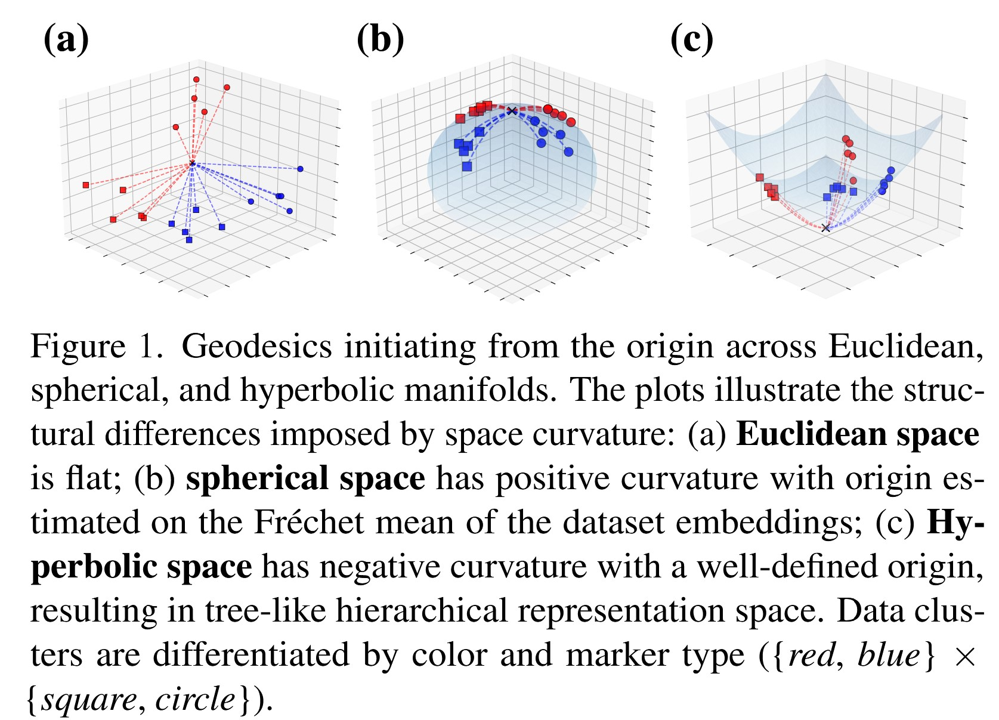
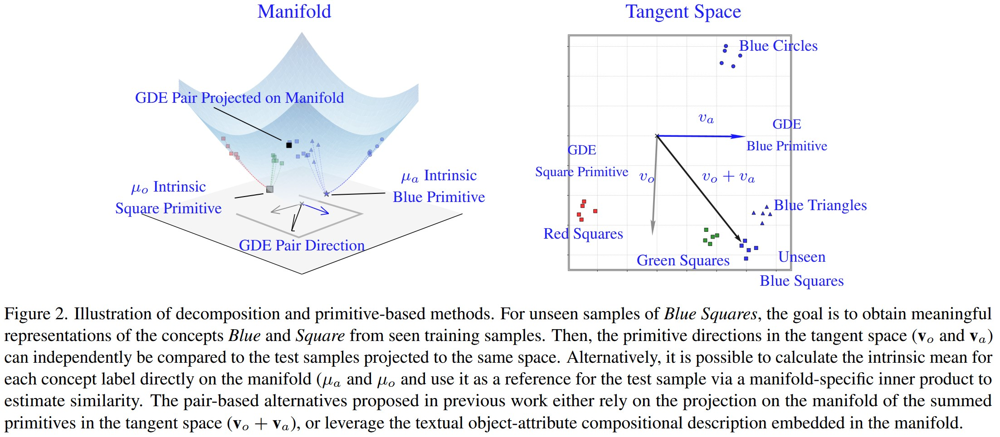
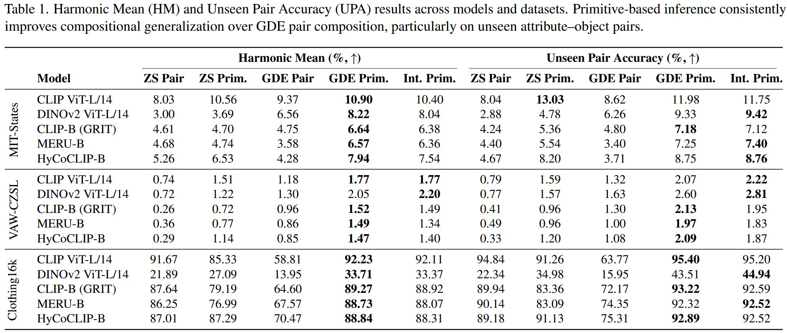
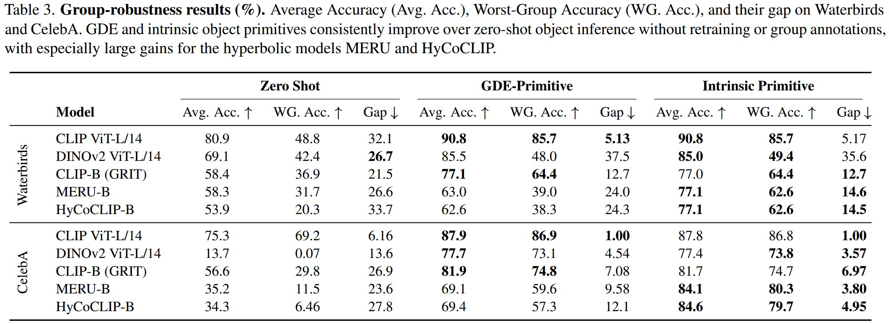

# Compositionality with Primitives: Geometric Deep Embedding for Compositional Generalization

**Official repository for the WACV 2027 paper** *"Compositionality with Primitives: Geometric Deep Embedding for Compositional Generalization"*

---

## Overview

This repository contains the code, data processing scripts, and evaluation pipeline for our work on learning compositional representations through geometric priors. We show that factorising visual concepts into **primitive** attribute and object embeddings — and composing them in appropriate non-Euclidean geometries (spherical, hyperbolic, or Euclidean) — yields strong zero-shot compositional generalisation and improved group robustness across a range of benchmarks.

The repository is organised as follows:

| Path                    | Contents                                                                                                         |
|-------------------------|------------------------------------------------------------------------------------------------------------------|
| `gde/`                  | Core library — dataset loading, geometry modules, factorisers (LDE / GDE / Primitive), VLM models, evaluators    |
| `compute_embeddings.py` | Batch script to compute image / text / primitive embeddings for all supported VLMs                               |
| `evaluate_czsl.py`      | Zero-shot and decomposition-based CZSL + Group-Robustness evaluation                                             |
| `compute_statistics.py` | Geometric statistics — variance, mutual information, radius-of-stratum                                           |
| `data/`                 | Dataset metadata (`.t7` files); images are **not** committed and must be supplied separately (see [Data](#data)) |
| `embedding/`            | Precomputed VLM embeddings (populated by `compute_embeddings.py`)                                                |
| `result/`               | Evaluation outputs — JSON metric files and statistics (populated by the evaluation scripts)                      |
| `checkpoint/`           | Model checkpoints                                                                                                |
| `assets/`               | Figures used in this README                                                                                      |

---

## Geometric Priors

Our method rests on the observation that different composition tasks benefit from different underlying curvatures. The figure below illustrates the geometries explored in this work.



- **Euclidean** — flat space; appropriate when attributes and objects combine linearly without hierarchical structure.
- **Spherical** — constant positive curvature; induces a compact composition space and is the natural choice for normalised VLM embeddings (e.g. OpenCLIP).
- **Hyperbolic** — constant negative curvature; captures hierarchical attribute–object relationships and is used for models pre-trained in hyperbolic space (MERU, HyCoClip).

The choice of geometry is determined automatically per model in the evaluation pipeline (see [Geometry selection](#geometry-selection) below).

---

## Method

The figure below summarises the full pipeline: a vision–language model provides primitive attribute and object embeddings; these are either composed in the chosen geometry or used as is using the scoring functions proposed, finall to be evaluated under both the standard CZSL protocol and a group-robustness protocol.



---

## Data

### Directory layout

```
data/
├── celebA/
│   ├── metadata_compositional-split-natural.t7
│   └── images/                    ← place images here
├── clothing16k/
│   ├── metadata_compositional-split-natural.t7
│   └── images/
├── mit-states/
│   ├── metadata_compositional-split-natural.t7
│   └── images/
├── ut-zap50k/
│   ├── metadata_compositional-split-natural.t7
│   └── images/
├── vaw-czsl/
│   ├── metadata_compositional-split-natural.t7
│   └── images/
└── waterbirds/
    ├── metadata_compositional-split-natural.t7
    └── images/
```

Each dataset directory must contain:

1. **`metadata_compositional-split-natural.t7`** — a Torch `.t7` tensor listing every image with its attribute, object, and split (`train` / `val` / `test`). These files are included in this repository.
2. **`compositional-split-natural/`** — a sub-directory containing `train_pairs.txt`, `val_pairs.txt`, and `test_pairs.txt`. Each line is `attr obj` (space-separated) or `attr+obj` (plus-separated).
3. **`images/`** — the raw image files, referenced by filename in the metadata. **These are not included in the repository** and must be downloaded from the respective dataset sources and placed in the corresponding `images/` sub-directory.

### Supported datasets

| Dataset       | Task focus                      |
|---------------|---------------------------------|
| `celebA`      | Face attributes                 |
| `clothing16k` | Fashion attribute–object pairs  |
| `mit-states`  | Natural scene states            |
| `ut-zap50k`   | Urban scene attributes          |
| `vaw-czsl`    | Visual attribute–object         |
| `waterbirds`  | Spurious correlation robustness |

### Environment variables

The default paths can be overridden by setting the following variables (or by creating a `.env` file):

| Variable         | Default        | Description                               |
|------------------|----------------|-------------------------------------------|
| `DATASET_DIR`    | `./data`       | Root directory containing dataset folders |
| `EMBEDDING_DIR`  | `./embedding`  | Directory for computed VLM embeddings     |
| `RESULTS_DIR`    | `./result`     | Directory for evaluation output JSONs     |
| `CHECKPOINT_DIR` | `./checkpoint` | Directory for model checkpoints           |
| `LOG_LEVEL`      | `INFO`         | Loguru log level                          |

---

## Dependencies

The project is implemented in Python 3.12 and uses:

- `torch` / `torchvision`
- `open-clip-torch` (for OpenCLIP backbones)
- `transformers` / `timm` (for Talk2DiNo and GRIT backbones)
- `geomloss` / `pytorch-manifold` (for hyperbolic/spherical geometry operations)
- `tqdm`, `python-dotenv`, `numpy`, `PIL`

Install with pip (adjust for your environment):

```bash
pip install torch torchvision
pip install open-clip-torch
pip install transformers timm
pip install tqdm python-dotenv numpy
```

---

## Usage

### 1. Compute embeddings

Run `compute_embeddings.py` to extract image, text, and primitive embeddings from the selected VLMs. Embeddings are saved under `EMBEDDING_DIR/<dataset>/<model_name>/`.

**Compute all model × dataset combinations:**

```bash
python compute_embeddings.py --all
```

**Select specific models, architectures, pretrainings, and datasets:**

```bash
python compute_embeddings.py \
    --model openclip grit talk2dino \
    --architecture ViT-B-16 ViT-L-14 \
    --pretraining openai \
    --dataset cgqa mit-states vaw-czsl
```

**Model registry:**

| `--model` value | Class        | Available architectures | Available pretrainings     |
|-----------------|--------------|-------------------------|----------------------------|
| `openclip`      | `OpenCLIP`   | `ViT-B-16`, `ViT-L-14`  | `openai`                   |
| `grit`          | `GRITModels` | `small`, `base`         | `meru`, `hycoclip`, `clip` |
| `talk2dino`     | `Talk2DiNo`  | `base`, `large`         | `v2`                       |

---

### 2. Evaluate (CZSL + Group Robustness)

Run `evaluate_czsl.py` to compute zero-shot, decomposition, and primitive-only metrics. Results are written to `RESULTS_DIR/<dataset>/<model_name>/{zero_shot,decomposition,primitive_only}.json`.

**Full evaluation (all models × all datasets):**

```bash
python evaluate_czsl.py --all
```

**Selective evaluation:**

```bash
python evaluate_czsl.py \
    --model openclip grit \
    --architecture ViT-B-16 ViT-L-14 \
    --pretraining laion2b s4b \
    --dataset cgqa mit-states vaw-czsl waterbirds
```

**With normalisation (Talk2DiNo) and dimensionality reduction (whitening):**

```bash
python evaluate_czsl.py \
    --model talk2dino \
    --dataset waterbirds celebA \
    --normalize \
    --dimred
```

**Output flags:**

| Flag                    | Effect                                                                 |
|-------------------------|------------------------------------------------------------------------|
| `--normalize`           | L2-normalise embeddings at load time (applied to Talk2DiNo by default) |
| `--dimred` / `--whiten` | Apply whitening-based dimensionality reduction before evaluation       |

---

### 3. Compute geometric statistics

Run `compute_statistics.py` to compute geometric variance, mutual information, and radius-of-stratum metrics from the embeddings. Results are written to `RESULTS_DIR/<dataset>/<model_name>/statistics/`.

```bash
python compute_statistics.py \
    --model openclip grit talk2dino \
    --arch ViT-B-16 ViT-L-14 \
    --pretraining laion2b s4b \
    --dataset cgqa mit-states \
    --normalize \
    --whiten
```

**Output files per model × dataset:**

| File                      | Content                                                 |
|---------------------------|---------------------------------------------------------|
| `statistics.pt`           | Full statistics dictionary (torch.Tensor)               |
| `geometric_variance.json` | Per-stratum geometric variance                          |
| `mutual_information.json` | Mutual information between attribute and object factors |
| `statistics_gde.pt`       | Statistics after GDE correction                         |
| `radius_stratum.json`     | Radius of stratum (hyperbolic models only)              |

---

### Geometry selection

The geometry is chosen automatically based on the model class and pretraining:

| Model       | Pretraining        | Geometry   |
|-------------|--------------------|------------|
| `grit`      | `meru`, `hycoclip` | hyperbolic |
| `grit`      | other              | spherical  |
| `openclip`  | any                | spherical  |
| `talk2dino` | (normalised)       | spherical  |
| `talk2dino` | (raw)              | euclidean  |

---

## Results

### Compositional Zero-Shot Learning (CZSL)

The table below reports the main CZSL results across all benchmarks. See the paper for full details on the seen/unseen split, bias sweep, and AUC computation.



### Group Robustness (GR)

The table below reports average accuracy, worst-group accuracy, and the robustness gap across the spurious-correlation benchmarks.



---

## Reproducing the paper

To reproduce all results from the paper:

```bash
# 1. Place dataset images in data/<dataset>/images/
# 2. Compute all embeddings (this may take several hours on a GPU)
python compute_embeddings.py --all

# 3. Run CZSL + Group Robustness evaluation
python evaluate_czsl.py --all

# 4. Compute geometric statistics
python compute_statistics.py --all
```

All outputs will be written under `result/` mirroring the `dataset/model/` hierarchy.

---

## Citation

If you find this repository useful, please cite our paper:

```bibtex
Coming Soon!
```

---
